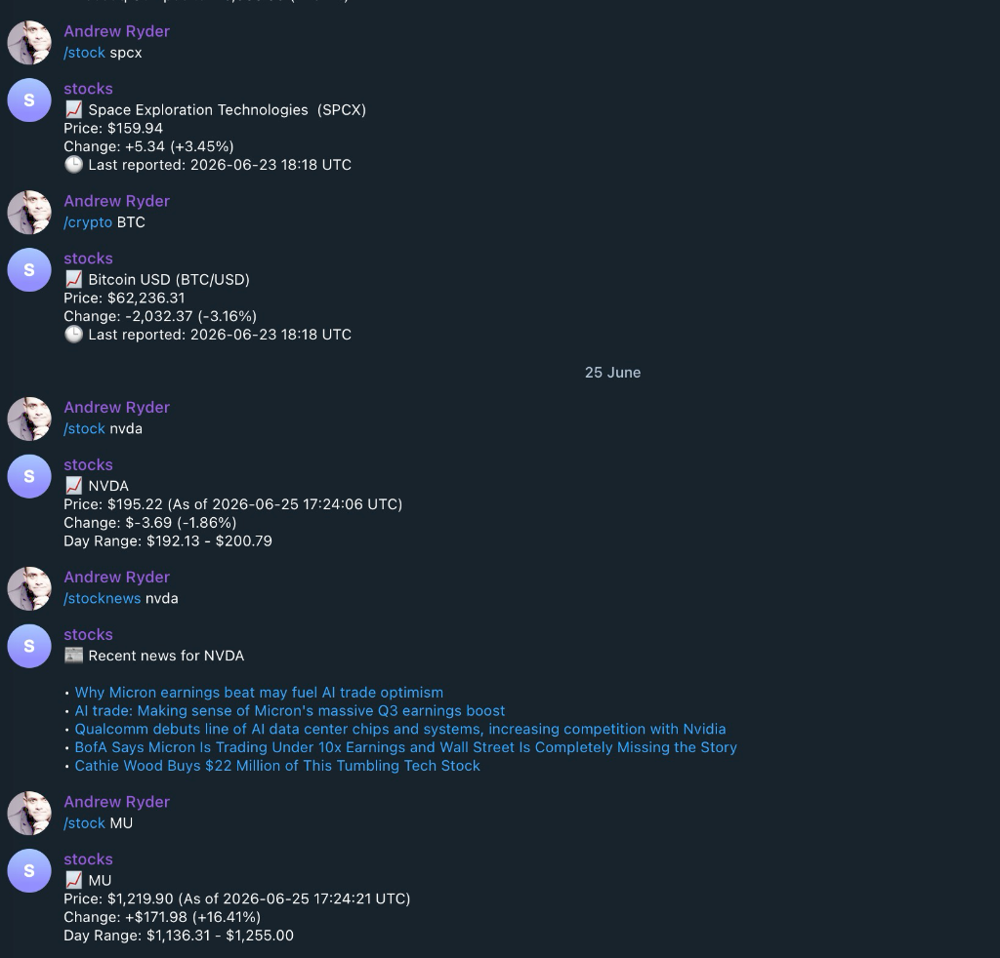

<!-- OpenGraph / Social Preview -->
<meta property="og:title" content="Telegram Financial Bot" />
<meta property="og:description" content="A lightweight, stateless Telegram bot for stock quotes with pre-market and after-hours pricing, market indices, crypto, and charts." />
<meta property="og:image" content="https://raw.githubusercontent.com/andrewtryder/telegram-finance-bot/main/docs/screenshot.png" />
<meta property="og:type" content="website" />
<meta property="og:url" content="https://github.com/andrewtryder/telegram-finance-bot" />

# Telegram Financial Bot

[](https://github.com/andrewtryder/telegram-finance-bot/actions/workflows/ci-cd.yml)
[](https://github.com/andrewtryder/telegram-finance-bot/blob/main/LICENSE)

A fast, lightweight, and completely **stateless** Telegram finance bot providing real-time and extended-hours stock quotes, major market indices, U.S. market futures, cryptocurrency quotes, symbol search, company fundamentals, news, and charts.

Runs serverless on **Cloudflare Workers Free** (Python runtime, zero ongoing hosting costs) or on **Railway / Docker / local** (webhooks or polling).



## Features

- `/stock AAPL` — Stock quote with **pre-market and after-hours trading**, session indicators, and timestamps
- `/crypto BTC` — 24/7 cryptocurrency quotes and trading ranges
- `/indices` — Major cash market indices (S&P 500, Dow Jones, Nasdaq) and active U.S. market futures
- `/compare AAPL MSFT` — Side-by-side quotes for 2–4 securities
- `/chart AAPL [1mo|3mo|6mo|1y]` — Dependency-free closing-price line chart PNG
- `/search Apple` — Yahoo Finance symbol lookup
- `/stockinfo AAPL` — Company profile, sector, industry, and valuation metrics
- `/stocknews AAPL` — Recent market news headlines
- `/marketcap AAPL` — Market capitalization
- `/admin stats` — In-memory command and error statistics (authorized admins only)

> [!NOTE]
> Persistent watchlists and price alerts have been retired to keep the bot completely stateless, instant, and free of database requirements. Historical data on previously used external databases (D1 or Railway SQLite volumes) is not automatically deleted and remains safely preserved externally until manually removed by the owner.

---

## Deployment Matrix

The bot is entirely stateless and requires **no database, no persistent volumes, no cron jobs, and no background workers**:

| Target | Transport | Database | Recommended | Notes |
|---|:---:|:---:|:---:|---|
| **Cloudflare Workers** | Webhook | None | **Yes (Primary)** | Zero cost on Workers Free tier. No persistent container. |
| **Railway Serverless** | Webhook | None | Optional | Automatically sleeps when idle (~5m inactive). |
| **Railway Standard** | Webhook | None | Optional | Stays awake; may incur continuous compute costs. |
| **Railway** | Polling | None | Optional | Requires an always-on process (not recommended for cost). |
| **Local / Docker** | Webhook | None | Supported | For local webhook testing (e.g. via ngrok or tunnel). |
| **Local / Dev** | Polling | None | Supported | Fastest way to run locally without public HTTPS URLs. |

---

## Extended-Hours Pricing (Pre-Market & After-Hours)

The bot provides extended-hours pricing whenever the market data provider makes it available:

- **Pre-Market:** Displays active pre-market prices (~4:00 AM–9:30 AM ET). Price change and percentage are calculated against the previous regular-session close.
- **Regular Session:** Displays live regular prices (~9:30 AM–4:00 PM ET) prominently with day range, 52-week range, volume, and open/close levels.
- **After-Hours:** Displays active post-market prices (~4:00 PM–8:00 PM ET). Price change and percentage are calculated against the most recent completed regular close.
- **Market Closed / Weekends:** Displays the final regular close, along with the most recent after-hours closing trade when available.
- **Anti-Stale Safeguards:** Stale pre-market trades from earlier sessions are never displayed as live quotes.
- **Cash Indices vs. Futures:** Cash indices (`^GSPC`, `^DJI`, `^IXIC`) do not have extended-hours trading and are clearly labeled as cash indices. Active U.S. index futures (`ES=F`, `NQ=F`, `YM=F`) are displayed in a separate section.
- **Cryptocurrency:** Crypto trades continuously 24/7/365 and is labeled accordingly without pre/post-market sessions.

---

## Primary Deployment: Cloudflare Workers (Free)

The bot runs as a pure Python Worker using Cloudflare's `python_workers` compatibility runtime. It executes on demand in response to Telegram webhooks with zero database overhead.

### 1. Prerequisites

- Node.js 22+ and `wrangler` (`npx wrangler --version`)
- A Cloudflare account

### 2. Configure Secrets

Set required secrets in Cloudflare:

```bash
npx wrangler secret put TELEGRAM_BOT_TOKEN
npx wrangler secret put TELEGRAM_WEBHOOK_SECRET
```

The webhook secret must contain 1–256 ASCII characters (`[A-Za-z0-9_-]`). Optionally set `ALLOWED_CHAT_IDS` and `ADMIN_USER_IDS` secrets as comma-separated integers.

For local emulation: create `.dev.vars` (never committed to git) and run `npx wrangler dev`.

### 3. Deploy Worker

Deploy to Cloudflare:

```bash
npx wrangler deploy
```

Your Worker URL will be: `https://<worker-name>.<subdomain>.workers.dev`.

### 4. Register Telegram Webhook

Use the built-in management CLI to register your Worker endpoint with Telegram:

```bash
export TELEGRAM_BOT_TOKEN="<bot-token>"
export TELEGRAM_WEBHOOK_SECRET="<webhook-secret>"
export WEBHOOK_URL="https://<worker-name>.<subdomain>.workers.dev/webhook"

python -m bot.manage_webhook register
```

To inspect webhook delivery status:
```bash
python -m bot.manage_webhook info
```

---

## Optional Deployment: Railway & Serverless App-Sleeping

Railway can run the stateless bot via its Python HTTP webhook server (`bot.webhook`).

### 1. Deploy via Webhook Mode

1. Deploy from this repository to Railway.
2. Set environment variables:
   - `BOT_MODE=webhook`
   - `TELEGRAM_BOT_TOKEN=...`
   - `TELEGRAM_WEBHOOK_SECRET=...`
3. Generate a Railway public domain (e.g. `https://mybot.up.railway.app`).
4. Register the webhook with Telegram:
   ```bash
   WEBHOOK_URL="https://mybot.up.railway.app/webhook" python -m bot.manage_webhook register
   ```

### 2. Enabling Railway Serverless / App-Sleeping

In Railway Service Settings, enable **App Sleeping / Serverless**.

- **How it works:** When no requests arrive for ~5 minutes, Railway suspends the container to 0 replicas, reducing billable CPU/memory time.
- **Zero background traffic:** The bot has no background pollers, metrics-push loops, or alert crons while idle, allowing the container to sleep uninterrupted.
- **Cold starts:** The first Telegram request to a sleeping container may take a few seconds to boot up. Telegram's automated webhook retries ensure updates are delivered reliably.

### 3. Optional Long Polling

For environments where continuous operation is explicitly acceptable:

```env
BOT_MODE=polling
TELEGRAM_BOT_TOKEN=...
```

> [!WARNING]
> Before running in polling mode, remove any registered webhook with `python -m bot.manage_webhook remove`. Telegram will reject polling while a webhook is active. Ensure exactly 1 replica is running.

---

## Quickstart: Local Development

1. Create a bot with [@BotFather](https://t.me/BotFather) and copy the token.
2. Clone repository and install dependencies with [uv](https://docs.astral.sh/uv/):
   ```bash
   uv sync --locked
   ```
3. Copy environment configuration:
   ```bash
   cp .env.example .env
   ```
4. Set `TELEGRAM_BOT_TOKEN` in `.env`.
5. Run locally in polling mode:
   ```bash
   BOT_MODE=polling uv run python -m bot.main
   ```

---

## Moving the Telegram Webhook Between Deployments

Use the included helper CLI (`bot.manage_webhook`) to seamlessly switch transports:

- **Check status:** `python -m bot.manage_webhook info`
- **Register Cloudflare:** `WEBHOOK_URL="https://<worker>.workers.dev/webhook" python -m bot.manage_webhook register`
- **Register Railway:** `WEBHOOK_URL="https://<railway-domain>/webhook" python -m bot.manage_webhook register`
- **Switch to Polling:** `python -m bot.manage_webhook remove`

Always ensure the previous instance is stopped before starting a poller.

---

## Testing & Verification

Run the complete test suite:

```bash
uv run pytest
```

Run linter and formatter checks:

```bash
uv run ruff check .
uv run ruff format --check .
```

Validate Cloudflare Worker bundling:

```bash
npx --yes wrangler@4 deploy --dry-run
```

---

## CI/CD & Security Analysis

- **Automated Validation:** Every push and pull request runs `pytest`, `ruff check`, `ruff format`, and `wrangler deploy --dry-run`.
- **Manual Deployments:** Deployments to Cloudflare or Railway are strictly manual via **Workflow Dispatch** (`none`, `cloudflare`, or `railway`). No credentials are committed or required for tests.
- **CodeQL Analysis:** GitHub CodeQL scans Python and GitHub Actions workflows. Note that if GitHub's Default CodeQL Setup was previously configured on a branch that contained JavaScript, GitHub's default matrix may attempt to scan JavaScript until this refactor is merged into `main`. Once merged into `main`, GitHub automatically recognizes that zero JavaScript remains and scopes scans to Python and Actions.
